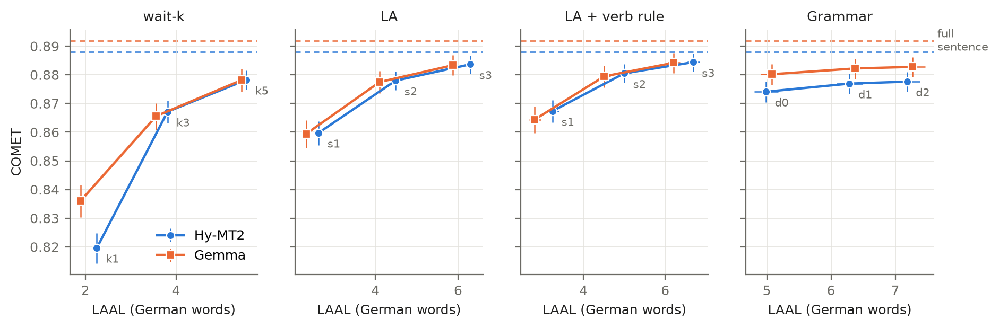

# Streaming German-English translation on a small compute budget

Simultaneous machine translation starts translating before the speaker has finished the sentence. With spoken output, a released word can't be taken back, so the real risk is **guessing**: the system says something the source hasn't said yet. German makes this concrete, because a German clause often puts its main verb last while English needs it early.

This project measures that trade-off on a laptop-sized budget. It compares a small general-purpose LLM with a small dedicated translation model, runs both through several streaming policies, and counts what each costs in quality, delay, computation and guesses that reach the listener.

Course project for T-725-MALV Natural Language Processing, Reykjavik University, autumn 2026, by Axel Klang and Michael Muehlberger. The full write-up is in `report.pdf`.



## What was compared

**Models**, both quantized to Q4_K_M and run through llama.cpp on an 8 GB M1 MacBook Air:

| Model | Type | Memory in use |
|---|---|---|
| Gemma 4 E2B (Google), instruction-tuned | general-purpose LLM | about 3.1 GiB |
| Hy-MT2-1.8B (Tencent) | dedicated translation model | about 1.4 GiB |

**Streaming policies.** German arrives one word at a time on a virtual clock (2.5 words per second). Every released English word is final.

- **Wait-k** starts after k German words and then releases about one English word per new German word.
- **Local agreement** calls the model every s German words and releases what two successive replies agree on.
- **Verb-and-number rule** (our addition to local agreement): the English may never contain more verbs or numbers than the German received so far. A new English verb beyond that count is held back until the German verb arrives.
- **Grammar-based chunking** (our addition, a first version): spaCy tags the German as it arrives, and the model is only called when a clause boundary is detected.

**Measures.** COMET, chrF and BLEU for quality; LAAL for lag in German words, plus a computation-aware version in seconds; inference time and tokens per German word for compute. Guessing is measured with an LLM judge (Claude Haiku), checked against a second judge (ChatGPT). It is counted at three levels: replies that contain a guess, guesses that reach the output, and released guesses that turn out wrong.

Data: 712 held-out FLORES+ devtest sentences (indices 300 to 1011), with 100 of them sampled for the guessing analysis. Significance comes from a paired bootstrap with 10,000 rounds.

## Main findings

- **The general model guessed less.** At matched lag, Gemma released about half as many unsupported guesses as Hy-MT2, and scored higher at low lag (+0.013 COMET under wait-k at three words). From about five words of lag the two were level.
- **The specialist was cheaper.** Hy-MT2 needed 25 to 35% less inference time per German word in every setting, and less than half the memory.
- **Local agreement beat wait-k** at the same lag for both models.
- **The verb rule cut released guesses** by about 40 to 45% at five to six words of lag. On quality alone it was no better than simply waiting longer.
- **Grammar-based chunking** came close to local agreement in quality with about three model calls per sentence instead of 7.5 to 21.5.
- **COMET barely sees guessing.** On a small probe it penalised German word order more than a wrong verb, so the guess measures separate the models more clearly than COMET does.

All numbers, with confidence intervals, are in `results/report_table.md`, `results/bootstrap.txt` and `results/findings.md`.

## Repository layout

```
pipeline/            the streaming pipeline and analysis used for the report
  data.py            loads FLORES+ sentences
  backend.py         prompt templates per model, one request to llama-server, timings and token counts
  policies.py        wait-k, local agreement (stride, verb rule switch) and grammar-based chunking
  verb_rule.py       the verb-and-number rule, with spaCy for German and English
  simulate.py        runs a policy over sentences on a virtual clock, one JSON line per sentence
  score.py           chrF, BLEU, COMET, LAAL, CA-LAAL, tokens and compute per German word
  judge.py           LLM judge: which replies contain a guess (prompt in rq2_prompt.txt)
  m3_judge.py        LLM judge: which released guesses are wrong (prompt in m3_prompt.txt)
  rq2_count.py       guess counts per run from the judge labels
  bootstrap.py       paired bootstrap over all report runs
  report_table.py    the full results table
  figures.py         the report figures
  examples.py        candidate examples for the error analysis
  align.py           word alignment input, from an earlier approach to guess detection
  night.sh           runs every report setting for one model unattended
  commands.md        every command with an explanation
results/             aggregate results: tables, bootstrap output, findings, figures, summary.json
rq2_validation/      second-judge check of guess detection (scripts and adjudication notes)
m3_validation/       second-judge check of wrong-guess labels (scripts and settled disagreements)
comet_probe/         how COMET reacts to word order against meaning errors
leak_check/          flags German words that leak into the English output
tagger_results/      how reliably spaCy tags German prefixes, with and without lookahead
rq2_ids.json         the 100 sentences of the guessing sample
pilot.py, walk.py, agree_test.py, verb_gate.py, tagger_prefix.py, show_prefix.py
                     September prototypes that settled the models, prompts and rules
CHANGELOG.md         every change to the scripts, with the reason for it
```

### Why the raw outputs aren't here

FLORES+ is an evaluation benchmark, and its maintainers ask users not to redistribute the data publicly where scrapers can reach it, so that it stays out of LLM training sets. Every per-sentence output file contains the German source and the English reference. Those files are therefore left out, and this repository holds the code and the aggregate results. Running the pipeline downloads FLORES+ from Hugging Face and recreates the outputs locally. `.gitignore` keeps them out of commits.

## Requirements

- An Apple Silicon Mac (developed on an M1 MacBook Air with 8 GB). Other platforms should work but are untested.
- Python 3.11.
- llama.cpp with `llama-server` on the PATH (`brew install llama.cpp`). A 2026 build is needed for Hy-MT2.
- A Hugging Face account that has accepted the FLORES+ terms at https://huggingface.co/datasets/openlanguagedata/flores_plus.
- For the guessing analysis only: the Claude Code CLI (`claude`), which the judge scripts call.
- About 10 GB of free disk for the environments, COMET and the model files.

## Setup

From the repository folder:

```bash
python3.11 -m venv .venv
source .venv/bin/activate
pip install -U -r requirements.txt
python -m spacy download de_core_news_lg
python -m spacy download en_core_web_md
```

COMET needs older library versions than the models, so it gets its own environment:

```bash
python3.11 -m venv .venv-comet
.venv-comet/bin/pip install -U -r requirements-comet.txt "numpy<2" "setuptools<81"
```

Then log in to Hugging Face so FLORES+ and the model files can be downloaded:

```bash
hf auth login
```

## Running

Start one model server in its own terminal and leave it running (only one fits in 8 GB):

```bash
llama-server -hf tencent/Hy-MT2-1.8B-GGUF:Q4_K_M --port 8080 -c 4096 -np 1 -ngl 99
llama-server -hf unsloth/gemma-4-E2B-it-GGUF:Q4_K_M --port 8080 -c 4096 -np 1 -ngl 99 --swa-full --no-mmproj
```

Then stream sentences through a policy, with `.venv` active:

```bash
python pipeline/simulate.py --arm hymt2-q4 --policy waitk --k 3 --n 10
python pipeline/simulate.py --arm hymt2-q4 --policy la --stride 1 --verb-rule --n 10 --live
python pipeline/simulate.py --arm hymt2-q4 --policy grammar --delay 1 --n 10
python pipeline/score.py results/pipeline/hymt2-q4_waitk3/*.jsonl
```

`--live` prints a word-by-word table of what the model proposes and what gets released. `--start 300 --n 712` selects the report sentences. To run every report setting for one model unattended, use `pipeline/night.sh hymt2-q4`. It starts and stops the server itself, and `pipeline/night.sh hymt2-q4 grammar` runs the grammar delays. The analysis then runs in this order:

```bash
.venv-comet/bin/python pipeline/score.py --comet results/pipeline/*/*.jsonl
python pipeline/judge.py <run file> --ids rq2_ids.json
python pipeline/m3_judge.py
python pipeline/bootstrap.py > results/bootstrap.txt
python pipeline/report_table.py
python pipeline/figures.py
```

`pipeline/commands.md` explains every flag.

## Method notes

- **Greedy decoding** (temperature 0, top-k 1) for both models, so runs are deterministic and a guess is the model's own most likely continuation.
- **Prefix forcing.** At each call the model gets the German prefix and continues from the English already released, so released words are never revised.
- **Words, not tokens,** are the unit throughout: German arrives word by word, agreement compares words, and releases are whole words.
- **Prompt caching** is on. Gemma needs `--swa-full`, or its sliding-window layers reuse far less of each prompt and it looks slower than it is.
- **Data split.** Devtest 0 to 299 was used to build and debug the pipeline, FLORES+ dev to tune the policies, and devtest 300 to 1011 only for the reported runs.

## Licences

- Gemma 4 is released under Google's Gemma terms of use. Hy-MT2-1.8B is released by Tencent under Apache 2.0.
- FLORES+ is CC BY-SA 4.0 with additional terms of use, and it is not included here.
